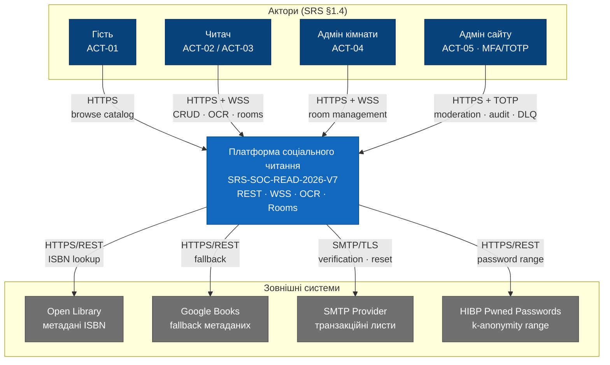
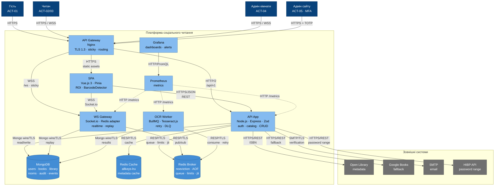

# Розділ 2. Проєктування архітектури системи

Цей розділ містить архітектурні моделі платформи соціального читання за моделлю C4 (Саймон Браун) та наскрізне трасування вимог до архітектурних рішень.

- [Специфікація вимог (SRS)](./srs.md)
- [Каталог архітектурних рішень (ADR)](./adr/)

---

## 2.1. Контекстне та контейнерне моделювання системи (C4 Model)

### 2.1.1. C4 Level 1 — System Context Diagram

**Опис вузлів Context:**

| Вузол | Тип | Трасування SRS | Призначення |
|---|---|---|---|
| Гість | Person | ACT-01 | Публічний каталог, публічні профілі. |
| Читач | Person | ACT-02 / ACT-03 | Бібліотека, цитати, відгуки, OCR, участь у кімнатах. |
| Адмін кімнати | Person | ACT-04 | Управління кімнатою, запрошення, виключення. |
| Адмін сайту | Person | ACT-05 | Модерація, аудит, DLQ; обов'язкова MFA/TOTP. |
| Платформа | System | [SRS-SOC-READ-2026-V7](./srs.md) | Центральна система; межі — SRS V7. |
| Open Library | System_Ext | [SRS-FUN-03.3a](./srs.md#srs-fun-02) | Первинне джерело метаданих. |
| Google Books | System_Ext | [SRS-FUN-03.3a](./srs.md#srs-fun-02) | Fallback-джерело метаданих. |
| SMTP | System_Ext | [SRS-FUN-01.6c2](./srs.md#srs-fun-01), [01.6d](./srs.md#srs-fun-01) | Verification/reset листи. |
| HIBP | System_Ext | [SRS-FUN-01.1](./srs.md#srs-fun-01) | Перевірка скомпрометованих паролів. |

**Протоколи Context:** HTTPS/TLS 1.3, WSS, SMTP/TLS.

---

### 2.1.2. C4 Level 2 — Container Diagram

**Опис контейнерів із трасуванням вимог:**

| Контейнер | Технологія | Відповідальність | Трасування SRS | Трасування ADR |
|---|---|---|---|---|
| API Gateway | Nginx | TLS 1.3, sticky sessions, маршрутизація `/api` і `/ws`, статика | [SRS-NFR-SEC-01](./srs.md#srs-nfr-sec), [SRS-FUN-08.1c](./srs.md#srs-fun-05) | — |
| SPA | Vue.js 3, Pinia, Vue Router, Canvas API | UI, ROI, BarcodeDetector/fallback | [SRS-NFR-FE-01–04](./srs.md#srs-nfr-fe) | — |
| API App | Node.js, Express, Zod, jsonwebtoken, bcrypt | REST: auth, catalog, library, quotes, rooms, moderation, DSR | [SRS-FUN-01](./srs.md#srs-fun-01)–[08](./srs.md#srs-fun-05) | — |
| WS Gateway | Node.js, Socket.io, Redis adapter | Realtime, sequence, replay, backpressure | [SRS-FUN-08.1a–c](./srs.md#srs-fun-05) | — |
| OCR Worker | Node.js, BullMQ, Tesseract.js | Async OCR, retry, DLQ | [SRS-FUN-05.1–05.9](./srs.md#srs-fun-03) | [ADR-001](./adr/0001-choice-of-technology.md) |
| MongoDB | MongoDB | Основне сховище, audit, deletion log, events | [SRS-FUN-02.3](./srs.md#srs-fun-01), [SRS-NFR-SEC-06](./srs.md#srs-nfr-sec) | — |
| Redis Cache | Redis allkeys-lru | Кеш метаданих/профілів | [SRS-FUN-03.4](./srs.md#srs-fun-02), [SRS-NFR-PERF-05](./srs.md#srs-nfr-perf) | — |
| Redis Broker | Redis noeviction, AOF | BullMQ, rate limit, jti denylist, idempotency, pub/sub | [SRS-FUN-05.2–05.7](./srs.md#srs-fun-03), [SRS-NFR-SEC-02](./srs.md#srs-nfr-sec), [SRS-FUN-08.1c](./srs.md#srs-fun-05) | [DC-03](./srs.md#dc-03) |
| Prometheus | Prometheus | Метрики | [SRS-NFR-REL-03](./srs.md#srs-nfr-rel) | — |
| Grafana | Grafana | Дашборди, алерти, burn-rate | [SRS-NFR-PERF-02](./srs.md#srs-nfr-perf), [SRS-NFR-REL-03](./srs.md#srs-nfr-rel) | — |

**Протоколи Container:** HTTPS/TLS 1.3, WSS, HTTP/2, MongoDB wire/TLS, RESP/TLS, SMTP/TLS.

**Трасування функціональних модулів SRS → контейнери:**

- Модуль автентифікації ([SRS-FUN-01](./srs.md#srs-fun-01)) → API App, MongoDB, Redis Broker.
- Модуль каталогу ([SRS-FUN-03](./srs.md#srs-fun-02)) → API App, Redis Cache, MongoDB.
- Модуль бібліотеки ([SRS-FUN-04](./srs.md#srs-fun-02)) → API App, MongoDB.
- Модуль OCR ([SRS-FUN-05](./srs.md#srs-fun-03)) → API App, OCR Worker, Redis Broker, MongoDB; рішення — [ADR-001](./adr/0001-choice-of-technology.md).
- Модуль цитат і агрегації ([SRS-FUN-06](./srs.md#srs-fun-04)–[07](./srs.md#srs-fun-04)) → API App, MongoDB.
- Модуль кімнат і спойлерів ([SRS-FUN-08](./srs.md#srs-fun-05)) → API App, WS Gateway, Redis Broker, MongoDB.
- Модерація, аудит, DLQ ([SRS-NFR-SEC-06](./srs.md#srs-nfr-sec), [SRS-FUN-05.7b](./srs.md#srs-fun-03)) → API App, OCR Worker, MongoDB, Redis Broker.
- Спостережуваність ([SRS-NFR-REL-03](./srs.md#srs-nfr-rel)) → Prometheus, Grafana.

---

## 2.2. Компонентне моделювання критичного сервісу системи

**Обраний критичний контейнер:** `API Application` (Node.js / Express / Zod / jsonwebtoken / bcrypt) з C4 Level 2.

**Обґрунтування вибору:** містить основне бізнес-навантаження — auth із MFA/CSRF/JWT, каскад зовнішніх каталогів, state machine бібліотеки, єдину fail-closed spoiler policy, агрегацію цитат, k-anonymity, DSR, idempotency та audit. Це найскладніший за кількістю інваріантів і за ризиком контейнер.

### 2.2.1. C4 Level 3 — Component Diagram

```mermaid
flowchart TB
    classDef inbound fill:#85bbf0,stroke:#5a82a6,color:#000000
    classDef core fill:#1168bd,stroke:#0b4884,color:#ffffff
    classDef domain fill:#08427b,stroke:#052e56,color:#ffffff
    classDef outbound fill:#438dd5,stroke:#2e6295,color:#ffffff
    classDef ext fill:#707070,stroke:#4d4d4d,color:#ffffff
    classDef store fill:#2e6295,stroke:#1f4568,color:#ffffff

    subgraph Inbound["Inbound · Presentation"]
        direction TB
        Router["API Router<br/>Express"]:::inbound
        MW["Middleware Chain<br/>correlationId · authGuard<br/>rbacGuard · csrfGuard<br/>rateLimiter · zodValidate<br/>errorHandler"]:::inbound
        AuthC["AuthController"]:::inbound
        CatC["CatalogController"]:::inbound
        LibC["LibraryController"]:::inbound
        QuoteC["QuoteController"]:::inbound
        RoomC["RoomController"]:::inbound
        OcrC["OcrJobController"]:::inbound
        AdminC["AdminController<br/>moderation · DLQ · audit"]:::inbound
        DsrC["DsrController"]:::inbound
    end

    subgraph Core["Core · Application Services"]
        direction TB
        AuthS["AuthService<br/>login · refresh · MFA"]:::core
        TokenS["TokenService<br/>RS256 · JWKS · jti"]:::core
        CatalogS["CatalogService<br/>ISBN · cascade"]:::core
        LibraryS["LibraryService<br/>state machine"]:::core
        QuoteS["QuoteService<br/>CRUD · visibility"]:::core
        AggS["AggregationService<br/>MinHash · JW ≥0.92<br/>k-anonymity"]:::core
        SpoilerS["SpoilerPolicyService<br/>fail-closed decision table"]:::core
        RoomS["RoomService<br/>invites · progress"]:::core
        OcrS["OcrJobService<br/>idempotency · retry"]:::core
        DsrS["DsrService<br/>export · delete · tombstone"]:::core
        ConsentS["ConsentService"]:::core
        AuditS["AuditService<br/>hash-chain append"]:::core
        IdemS["IdempotencyService<br/>scope · lock · hash"]:::core
        RateS["RateLimitService<br/>Token Bucket"]:::core
    end

    subgraph Domain["Domain"]
        direction TB
        Entities["Entities<br/>User · Book · LibraryRecord<br/>Quote · Room · OcrJob"]:::domain
        Policies["Domain Policies<br/>StateMachine · SpoilerRules"]:::domain
        Errors["Domain Errors<br/>RFC 9457 mapping"]:::domain
    end

    subgraph Outbound["Outbound · Infrastructure"]
        direction TB
        UserRepo["UserRepository"]:::outbound
        BookRepo["BookRepository"]:::outbound
        LibRepo["LibraryRepository"]:::outbound
        QuoteRepo["QuoteRepository"]:::outbound
        RoomRepo["RoomRepository"]:::outbound
        OcrRepo["OcrJobRepository"]:::outbound
        AuditRepo["AuditRepository"]:::outbound
        TombRepo["DeletionLogRepository"]:::outbound
        ExtCat["ExternalCatalogClient<br/>OpenLibrary + GoogleBooks<br/>Circuit Breaker"]:::outbound
        HibpC["HibpClient<br/>range API"]:::outbound
        SmtpC["SmtpClient"]:::outbound
        CacheC["CacheClient<br/>Redis allkeys-lru"]:::outbound
        QueueC["QueueClient<br/>BullMQ · denylist · locks"]:::outbound
        MetricsC["MetricsClient<br/>prom-client"]:::outbound
    end

    subgraph Store["Data Stores"]
        Mongo[("MongoDB")]:::store
        Cache[("Redis Cache")]:::store
        Broker[("Redis Broker")]:::store
    end

    subgraph Ext["External Systems"]
        OL["Open Library"]:::ext
        GB["Google Books"]:::ext
        HIBP["HIBP API"]:::ext
        SMTP["SMTP Provider"]:::ext
    end

    Router --> MW
    MW --> AuthC
    MW --> CatC
    MW --> LibC
    MW --> QuoteC
    MW --> RoomC
    MW --> OcrC
    MW --> AdminC
    MW --> DsrC

    AuthC --> AuthS
    CatC --> CatalogS
    LibC --> LibraryS
    QuoteC --> QuoteS
    RoomC --> RoomS
    OcrC --> OcrS
    AdminC --> AuditS
    DsrC --> DsrS

    AuthS --> TokenS
    AuthS --> ConsentS
    AuthS --> UserRepo
    AuthS --> HibpC
    AuthS --> SmtpC
    AuthS --> AuditS

    TokenS --> QueueC

    CatalogS --> ExtCat
    CatalogS --> BookRepo
    CatalogS --> CacheC
    CatalogS --> IdemS

    LibraryS --> LibRepo
    LibraryS --> Policies
    LibraryS --> AuditS

    QuoteS --> QuoteRepo
    QuoteS --> SpoilerS
    QuoteS --> AggS
    QuoteS --> AuditS

    AggS --> QuoteRepo
    AggS --> Policies

    SpoilerS --> Policies
    SpoilerS --> LibRepo

    RoomS --> RoomRepo
    RoomS --> LibRepo
    RoomS --> SpoilerS
    RoomS --> AuditS

    OcrS --> OcrRepo
    OcrS --> QueueC
    OcrS --> IdemS

    DsrS --> UserRepo
    DsrS --> LibRepo
    DsrS --> QuoteRepo
    DsrS --> RoomRepo
    DsrS --> OcrRepo
    DsrS --> TombRepo
    DsrS --> AuditS

    ConsentS --> UserRepo
    ConsentS --> AuditS

    AuditS --> AuditRepo

    IdemS --> QueueC
    RateS --> QueueC

    UserRepo --> Mongo
    BookRepo --> Mongo
    LibRepo --> Mongo
    QuoteRepo --> Mongo
    RoomRepo --> Mongo
    OcrRepo --> Mongo
    AuditRepo --> Mongo
    TombRepo --> Mongo

    CacheC --> Cache
    QueueC --> Broker

    ExtCat --> OL
    ExtCat --> GB
    HibpC --> HIBP
    SmtpC --> SMTP
```

**Опис компонентів із трасуванням:**

| Компонент | Роль | Трасування SRS | Трасування ADR |
|---|---|---|---|
| API Router | Маршрутизація `/api/v1` | [SRS-NFR-REL-06](./srs.md#srs-nfr-rel) | — |
| Middleware Chain | Єдиний конвеєр: `correlationId → authGuard → rbacGuard → csrfGuard → rateLimiter → zodValidate → errorHandler` | [SRS-FUN-01.8](./srs.md#srs-fun-01), [01.9](./srs.md#srs-fun-01), [SRS-NFR-SEC-02](./srs.md#srs-nfr-sec), [SRS-NFR-REL-03](./srs.md#srs-nfr-rel) | — |
| AuthController | Auth endpoints | [SRS-FUN-01.1–01.10](./srs.md#srs-fun-01) | — |
| CatalogController | Catalog endpoints | [SRS-FUN-03.1–03.6](./srs.md#srs-fun-02) | — |
| LibraryController | Library endpoints | [SRS-FUN-04.1–04.2](./srs.md#srs-fun-02) | — |
| QuoteController | Quote endpoints + reveal | [SRS-FUN-06.1–06.2](./srs.md#srs-fun-04), [08.4b](./srs.md#srs-fun-05) | — |
| RoomController | Room endpoints | [SRS-FUN-08.2–08.3](./srs.md#srs-fun-05) | — |
| OcrJobController | OCR endpoints + Idempotency-Key | [SRS-FUN-05.1–05.8](./srs.md#srs-fun-03) | [ADR-001](./adr/0001-choice-of-technology.md) |
| AdminController | Модерація, DLQ, audit | [SRS-FUN-05.7b](./srs.md#srs-fun-03), [SRS-NFR-SEC-06](./srs.md#srs-nfr-sec) | — |
| DsrController | DSR endpoints | [SRS-FUN-02.3a–02.3c](./srs.md#srs-fun-01) | — |
| AuthService | Login, refresh, MFA, reset | [SRS-FUN-01.1–01.7](./srs.md#srs-fun-01), [01.10](./srs.md#srs-fun-01) | — |
| TokenService | RS256, JWKS, jti denylist | [SRS-FUN-01.2](./srs.md#srs-fun-01), [01.3](./srs.md#srs-fun-01), [01.9](./srs.md#srs-fun-01) | — |
| CatalogService | ISBN, cascade, single-flight | [SRS-FUN-03.1–03.6](./srs.md#srs-fun-02) | — |
| LibraryService | State machine | [SRS-FUN-04.1](./srs.md#srs-fun-02) | — |
| QuoteService | CRUD, delegation | [SRS-FUN-06.1–06.2](./srs.md#srs-fun-04) | — |
| AggregationService | MinHash/LSH, Jaro-Winkler, k≥5 | [SRS-FUN-07.1–07.4](./srs.md#srs-fun-04) | — |
| SpoilerPolicyService | Єдина fail-closed decision table | [SRS-FUN-08.4a](./srs.md#srs-fun-05), [04.3](./srs.md#srs-fun-02) | — |
| RoomService | Кімнати, invite, progress | [SRS-FUN-08.2–08.3](./srs.md#srs-fun-05) | — |
| OcrJobService | Idempotency, retry, DLQ, 410 | [SRS-FUN-05.1–05.9](./srs.md#srs-fun-03) | [ADR-001](./adr/0001-choice-of-technology.md) |
| DsrService | Export, delete, tombstone | [SRS-FUN-02.3a–02.3c](./srs.md#srs-fun-01) | — |
| ConsentService | Grant/revoke | [SRS-FUN-02.2](./srs.md#srs-fun-01) | — |
| AuditService | Append-only hash-chain | [SRS-NFR-SEC-06](./srs.md#srs-nfr-sec) | — |
| IdempotencyService | Scope, lock, hash, TTL | [SRS-FUN-05.2–05.3](./srs.md#srs-fun-03) | — |
| RateLimitService | Token Bucket | [SRS-NFR-SEC-02](./srs.md#srs-nfr-sec) | — |
| Domain Entities / Policies / Errors | Чисті доменні моделі | [SRS-FUN-04.1](./srs.md#srs-fun-02), [08.4a](./srs.md#srs-fun-05), [SRS-NFR-REL-06](./srs.md#srs-nfr-rel) | — |
| Усі Repositories | Mongoose, індекси, optimistic locking | [SRS-NFR-REL-06](./srs.md#srs-nfr-rel) | — |
| AuditRepository | Append-only | [SRS-NFR-SEC-06](./srs.md#srs-nfr-sec) | — |
| DeletionLogRepository | Tombstone | [SRS-FUN-02.3c](./srs.md#srs-fun-01) | — |
| ExternalCatalogClient | Circuit Breaker, status matrix | [SRS-FUN-03.3a–03.3c](./srs.md#srs-fun-02), [SRS-NFR-REL-02](./srs.md#srs-nfr-rel) | — |
| HibpClient | k-anonymity, fail-closed | [SRS-FUN-01.1](./srs.md#srs-fun-01) | — |
| SmtpClient | Transactional only | [SRS-FUN-01.6c2](./srs.md#srs-fun-01), [01.6d](./srs.md#srs-fun-01) | — |
| CacheClient | allkeys-lru, positive-only | [SRS-FUN-03.4](./srs.md#srs-fun-02), [SRS-NFR-PERF-05](./srs.md#srs-nfr-perf) | — |
| QueueClient | BullMQ, denylist, locks | [SRS-FUN-05.2–05.7](./srs.md#srs-fun-03), [SRS-NFR-SEC-02](./srs.md#srs-nfr-sec), [SRS-FUN-08.1c](./srs.md#srs-fun-05) | [DC-03](./srs.md#dc-03) |
| MetricsClient | prom-client, гістограми | [SRS-NFR-PERF-02](./srs.md#srs-nfr-perf), [SRS-NFR-REL-03](./srs.md#srs-nfr-rel) | — |

**Протоколи внутрішньопроцесної взаємодії:**

- Router → Middleware → Controllers: Express middleware chain (sync function calls).
- Controllers → Services: Dependency Injection через `req.app.locals.container` (interface calls).
- Services → Repositories/Clients: DI через конструктор; залежність на інтерфейс, не на реалізацію (Dependency Inversion).
- Services → Domain Policies: чисті функції (sync).
- Repositories → MongoDB: Mongoose, MongoDB wire protocol/TLS.
- CacheClient → Redis Cache: ioredis, RESP/TLS.
- QueueClient → Redis Broker: ioredis + BullMQ, RESP/TLS.
- ExternalCatalogClient → Open Library / Google Books: undici, HTTPS/REST.
- HibpClient → HIBP: undici, HTTPS/REST.
- SmtpClient → SMTP: nodemailer, SMTP/TLS.

---

## 2.3. Документування архітектурних рішень (ADR)

Повний текст затвердженого архітектурного рішення:

- [ADR-001: Вибір механізму оптичного розпізнавання тексту для асинхронного контуру OCR](./adr/0001-choice-of-technology.md) — статус: Затверджено.

**Коротке трасування ADR-001:**

| Рішення | Впливає на контейнер | Трасування SRS |
|---|---|---|
| Tesseract.js у складі ізольованого воркера BullMQ | OCR Worker | [SRS-FUN-05](./srs.md#srs-fun-03), [SRS-NFR-PERF-03](./srs.md#srs-nfr-perf), [SRS-NFR-SEC-04](./srs.md#srs-nfr-sec), [SRS-NFR-REL-02](./srs.md#srs-nfr-rel) |